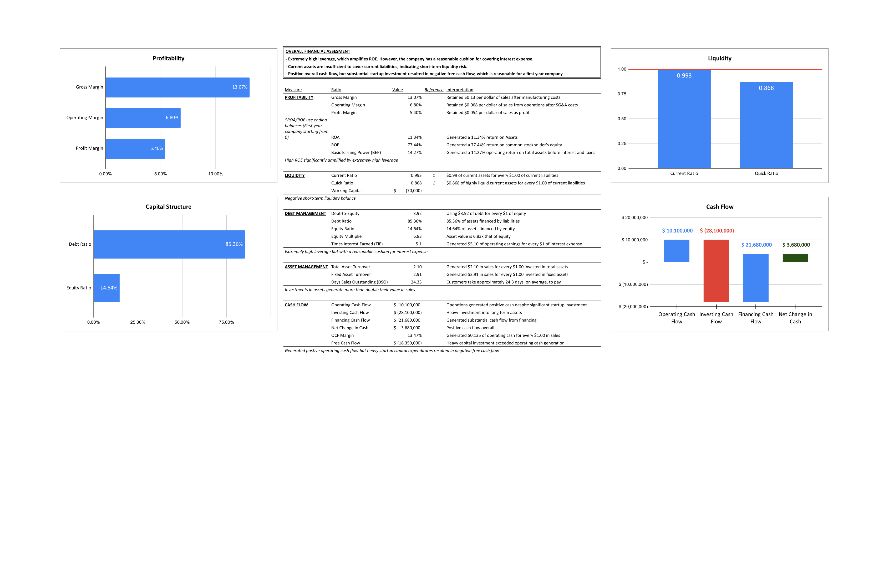

# VoltaDrive Financial Modeling & Three-Statement Analysis

## Overview

This project develops a financial model and financial statement analysis for VoltaDrive, a hypothetical truck manufacturing company in its first year of operations.

Built in Microsoft Excel, the project connects manufacturing assumptions, cost accounting, financial statements, cash flow analysis, and financial ratios to evaluate the company's profitability, liquidity, leverage, and operating efficiency.

The model incorporates an income statement, statement of retained earnings, balance sheet, statement of cash flows, schedule of goods manufactured, and financial ratio analysis.

## Project Objectives

The objectives of this project are to:

- Translate operating assumptions into financial statements.
- Calculate manufacturing costs and cost of goods manufactured.
- Evaluate profitability through financial margins and return ratios.
- Assess short-term liquidity and the company's ability to meet its obligations.
- Analyze capital structure, financial leverage, and interest coverage.
- Evaluate asset utilization and operating cash flow.
- Identify financial strengths, risks, and areas requiring further analysis.

## Tools & Skills

- **Microsoft Excel:** Financial modeling, formulas, structured worksheets, and financial calculations.
- **Financial Modeling:** Translating operating assumptions into integrated financial outputs.
- **Financial Statement Analysis:** Income statement, balance sheet, retained earnings, and cash flow statement preparation.
- **Cost Accounting:** Direct materials, direct labor, manufacturing overhead, and cost of goods manufactured.
- **Ratio Analysis:** Profitability, liquidity, leverage, asset management, and cash flow ratios.
- **Business Analysis:** Interpreting financial results and identifying potential risks.

## Model Assumptions

The model uses the following operating assumptions:

- VoltaDrive begins operations at the start of 2025 with no opening retained earnings.
- The company manufactures and sells 300 trucks during the year.
- The selling price is $250,000 per truck.
- Direct materials cost $180,000 per truck.
- Direct labor costs $20,000 per truck.
- Manufacturing overhead and selling, general, and administrative expenses are included in the model.
- The company purchases manufacturing equipment, buildings, and land.
- The company finances operations through common stock issuance and bond financing.
- The model incorporates a $20,000 dividend and interest expense on outstanding bonds.

These assumptions are used to produce the financial statements and evaluate the company's first-year financial performance.

## Key Financial Results

The model produces the following results for the year ended December 31, 2025:

| Metric | Model Result |
|---|---:|
| Units sold | 300 trucks |
| Revenue | $75,000,000 |
| Cost of goods sold | $65,200,000 |
| Gross profit | $9,800,000 |
| Operating income | $5,100,000 |
| Net income | $4,050,000 |
| Total assets | $35,730,000 |
| Total liabilities | $30,500,000 |
| Stockholders' equity | $5,230,000 |
| Operating cash flow | $10,100,000 |
| Investing cash flow | -$28,100,000 |
| Financing cash flow | $21,680,000 |
| Ending cash balance | $3,680,000 |

These figures are based on the assumptions and calculations contained in the workbook.

## Financial Analysis Highlights

### Profitability

- Gross profit margin is approximately 13.1%.
- Operating profit margin is approximately 6.8%.
- Net profit margin is approximately 5.4%.
- Return on assets is approximately 11.3%.
- Return on equity is approximately 77.4%.

The company generates positive earnings during its first year. However, return on equity should be interpreted in the context of the company's relatively small equity base and substantial financial leverage.

### Liquidity

- Current ratio is approximately 0.99.
- Quick ratio is approximately 0.87.
- Working capital is negative by approximately $70,000.

These measures indicate limited short-term liquidity. Current liabilities slightly exceed current assets, and highly liquid assets alone are insufficient to cover current liabilities.

### Debt Management

- Approximately 85.4% of assets are financed by liabilities.
- The model reports times interest earned of approximately 5.1 times.
- Financial leverage substantially increases the company's exposure to debt obligations.

Although operating earnings provide a reasonable cushion over interest expense in the model, the high proportion of liabilities warrants close monitoring.

### Cash Flow

- Operating activities generate $10.1 million in cash.
- Investing activities use $28.1 million, primarily for long-term assets.
- Financing activities provide $21.68 million.
- Ending cash is $3.68 million.

The company generates positive operating cash flow but makes substantial capital investments. The difference between operating cash generation and capital expenditure highlights the importance of evaluating free cash flow alongside net income.

## Workbook Structure

The Excel workbook contains seven worksheets:

| Worksheet | Purpose |
|---|---|
| Financial Analysis | Calculates and interprets financial ratios across profitability, liquidity, debt management, asset management, and cash flow. |
| Key Assumptions | Documents operating assumptions, per-unit costs, financing, and year-end balances used by the model. |
| Schedule of Goods Manufactured | Calculates manufacturing costs and cost of goods manufactured. |
| Income Statement | Reports revenue, cost of goods sold, operating expenses, and net income. |
| Retained Earnings | Reconciles beginning retained earnings, net income, dividends, and ending retained earnings. |
| Balance Sheet | Summarizes year-end assets, liabilities, and stockholders' equity. |
| Statement of Cash Flows | Reconciles operating, investing, and financing cash flows to the ending cash balance. |

## Methodology

1. Establish operating, production, expense, and financing assumptions.
2. Calculate direct materials, direct labor, manufacturing overhead, and total manufacturing costs.
3. Determine cost of goods manufactured and cost of goods sold.
4. Prepare the income statement and calculate net income.
5. Reconcile retained earnings after dividends.
6. Prepare the balance sheet using the modeled asset, liability, and equity balances.
7. Calculate operating, investing, and financing cash flows.
8. Calculate financial ratios and interpret the company's financial performance and risks.

## Key Takeaways

The model illustrates several important financial relationships:

- **Profitability does not guarantee liquidity.** A company can report positive net income while still facing short-term liquidity pressure.
- **Capital-intensive growth requires financing.** Significant investment in equipment and other long-term assets can consume cash even when operations are profitable.
- **Leverage amplifies returns and risk.** A relatively small equity base can produce a high return on equity, but debt obligations increase financial risk.
- **Integrated statements improve financial visibility.** Reviewing the income statement, balance sheet, and cash flow statement together provides a more complete view than evaluating any one statement independently.
- **Assumptions drive the model's conclusions.** Changes in unit economics, sales volume, operating costs, or financing can materially affect the company's financial position.

## Files

- `voltadrive_financial_modeling_three_statement_analysis.xlsx` - Excel workbook containing the assumptions, manufacturing cost schedule, financial statements, and ratio analysis.
- `images/financial_analysis_preview.png` - Screenshot of the financial analysis worksheet.

## How to Use

1. Download the Excel workbook from this repository.
2. Open it in Microsoft Excel.
3. Review **Key Assumptions** to understand the inputs driving the model.
4. Examine the manufacturing cost schedule and financial statements.
5. Open **Financial Analysis** to review the calculated ratios and interpretations.
6. Trace important results back to their underlying assumptions and supporting statements.

## Skills Demonstrated

Financial Modeling · Microsoft Excel · Three-Statement Analysis · Financial Statement Preparation · Cost Accounting · Ratio Analysis · Profitability Analysis · Liquidity Analysis · Capital Structure · Cash Flow Analysis · Business Decision Support
